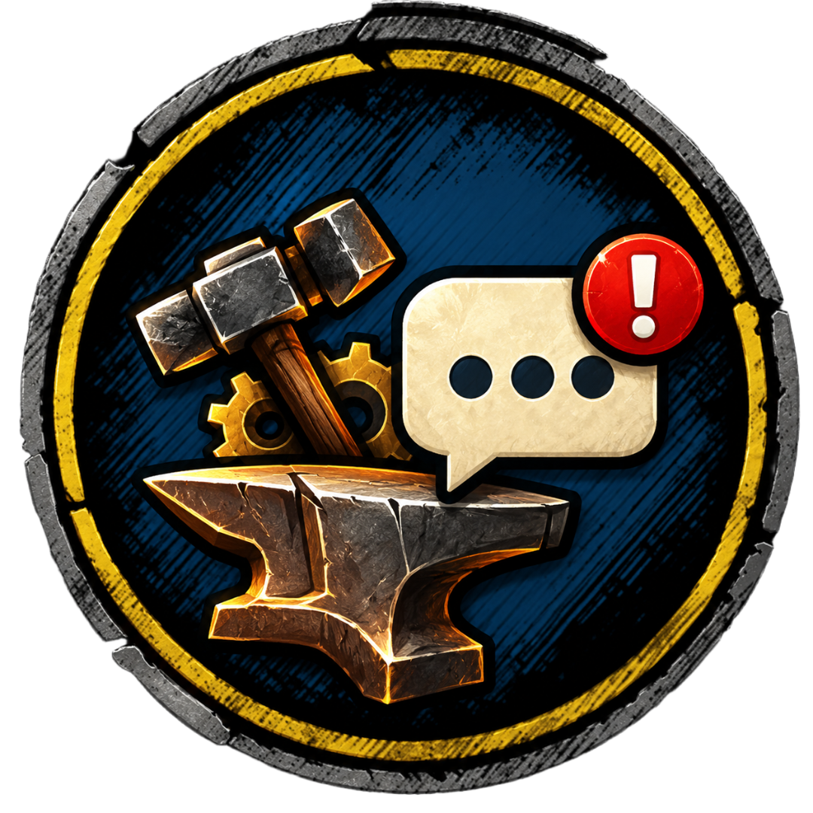
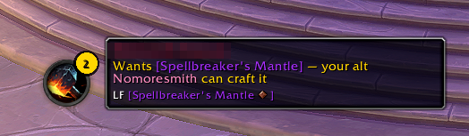
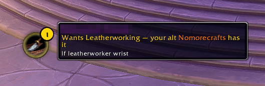
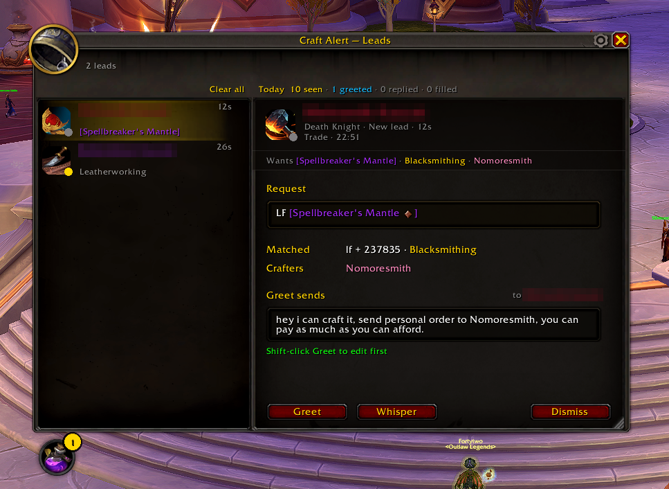
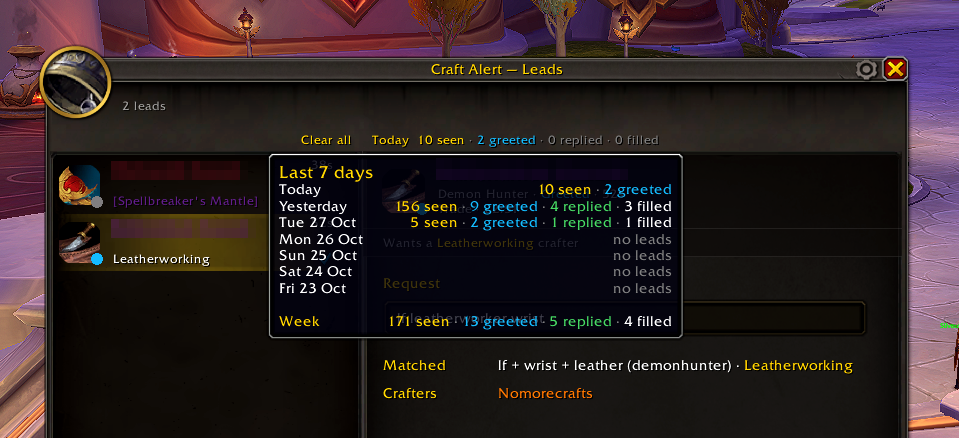
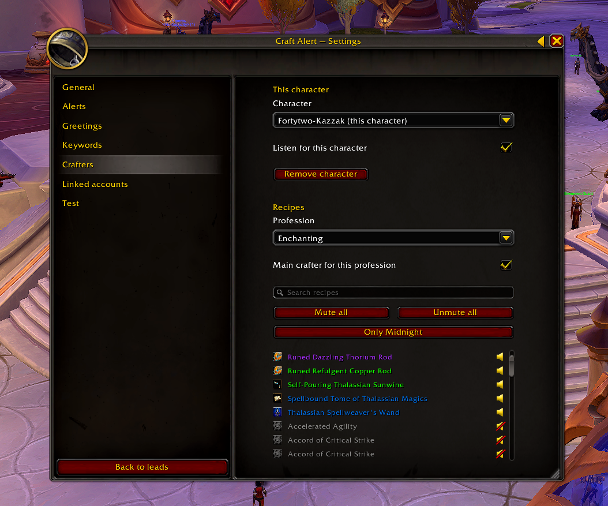
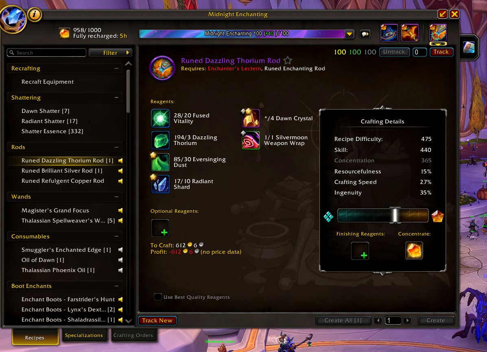
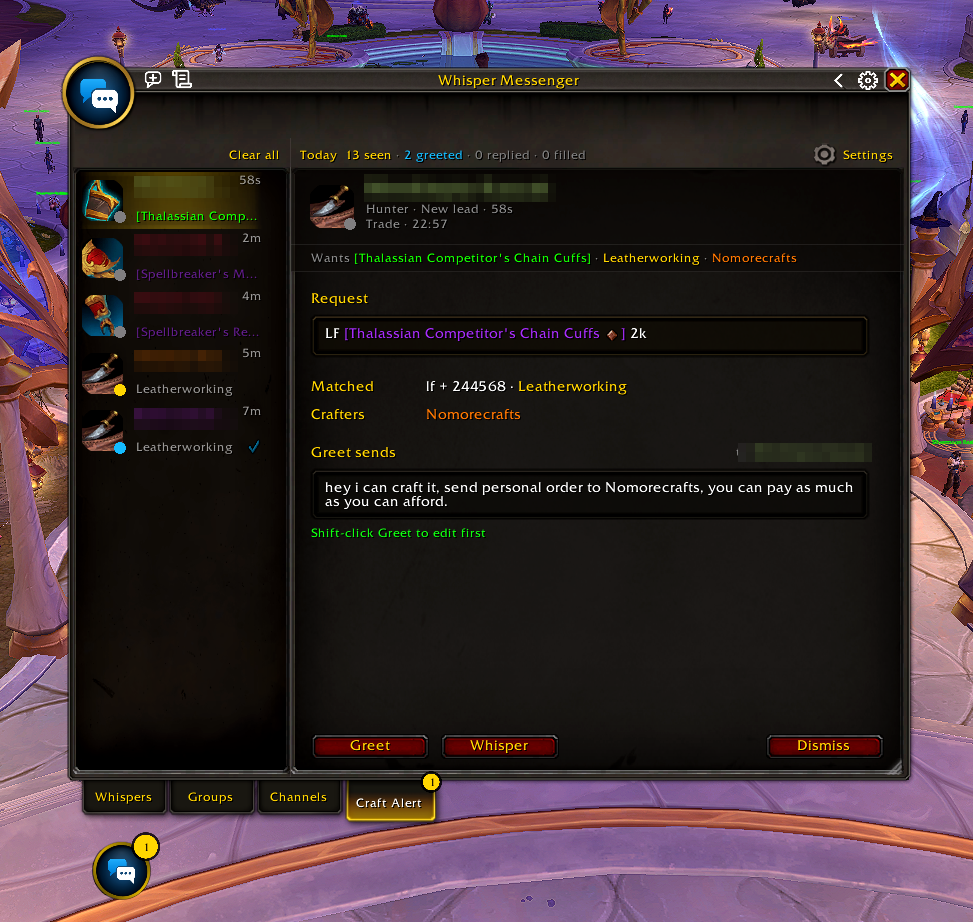

# Craft Alert

Craft Alert watches Trade chat for people asking for something one of your characters can craft, then shows a toast so you can greet them with one click. Open each profession window once and it knows your recipes across every character on the account. It never whispers on its own: every message comes from your click or keybind. Works on Retail, WoW: Forever, and the Classic flavors (Era, TBC Anniversary, Wrath, Cata, MoP) from one folder.

## Screenshots

A toast beside the launcher ring when someone asks for something your alt can craft:

The leads window, with the selected request, who can craft it and the greeting that Greet sends:

Hover the day's counts for the last 7 days:

Settings, opened with the gear on the window's title bar. The Crafters page picks a main crafter per profession and mutes recipes:

The same mute switch sits on each recipe in your profession window: click the speaker to mute or unmute it.

With WhisperMessenger installed, the leads move into its Craft Alert tab:

## What it does

- Listens in Trade and Services where the game has them (General, LookingForGroup, Guild and Communities can be turned on) for requests such as "LF plate belt", "WTB [item link]" or "LF enchanter".
- Shows a toast beside its launcher ring with what the customer wants and which of your characters can craft it. Left-click greets, shift-click lets you edit the greeting first, ctrl-click opens an empty whisper, right-click dismisses.
- Opens the greeting in the chat box for you to send instead when you are AFK, greet more than six times a minute, greet the same lead twice, or click a lead that just appeared.
- Keeps every open request in a leads window: the list on the left, the selected request in full on the right, with Greet, Whisper and Dismiss buttons.
- Counts the requests you saw, greeted and got a reply from each day, and tells you what came in while you were AFK.
- Picks the best of your characters for each request, and lets you choose a main crafter per profession.
- Turns itself off in dungeons, raids, battlegrounds, arenas and delves.
- With WhisperMessenger installed, the leads move into a WhisperMessenger tab and greetings open as WhisperMessenger conversations.

## Install

1. Download Craft Alert and unzip it.
2. Put the `CraftAlert` folder in the `Interface/AddOns` folder of your game version, for example `World of Warcraft/_retail_/Interface/AddOns`.
3. Start the game (or `/reload`) and check that Craft Alert is enabled in the AddOns list.
4. On each character, open each crafting profession window once, so Craft Alert learns its recipes. The login chat line tells you which professions are still missing.

## Commands

- `/ca` (or `/craftalert`) shows or hides the leads window.
- `/ca config` opens the settings. The gear on the leads window's title bar opens them too.
- `/ca test <a trade line>` runs the line through Craft Alert as if someone had said it in Trade, prints what matched and why, and makes a test lead you can click. Test greetings send nothing. Add `as <class>` to set the test customer's class (`/ca test as warrior LF belt`), or use `/ca test reply` to fake the customer's reply.
- `/ca perf` times the chat scan and reports every minute until you run it again.

Key bindings for greeting the latest lead, dismissing it, and showing or hiding the leads window are under Craft Alert in the game's Key Bindings.

## Linked accounts

Craft Alert can name crafters from your other Battle.net account, so a request on this account can be greeted for your alt over there. Both accounts need the same game version.

1. On the account that has the crafters, open Settings → Linked accounts and click the Export string box. It selects the whole string; press Ctrl+C.
2. On the other account, open Settings → Linked accounts, paste the string into the Import string box with Ctrl+V and click Import.
3. The page lists the characters you imported and when. Importing again later updates them and keeps your choices for them (on or off, main crafter).

## Moving from CraftScan (Retail)

1. Keep CraftScan enabled for one login.
2. At login Craft Alert offers once to import this account's CraftScan characters, recipes and greetings. Click Import. Recipes CraftScan isn't scanning come in muted, and anything Craft Alert already has stays as it is.
3. Missed the offer or clicked Decline? Settings → Linked accounts → Import from CraftScan does the same.
4. Once the import reports how many characters and recipes came in (in chat, or on the page), you can disable CraftScan.

## Privacy

Craft Alert reads chat inside the game and keeps what it learns in its own saved variables on your computer. Nothing leaves the game except what you choose to send: the greeting whisper, and just before each greeting Craft Alert sends for you (not ones it opens in the chat box), a hidden addon message to the same player (`Q:CraftAlert`, under the `robots.txt` prefix) so their addons can tell the whisper came from an addon. The Linked accounts string goes only where you paste it.
